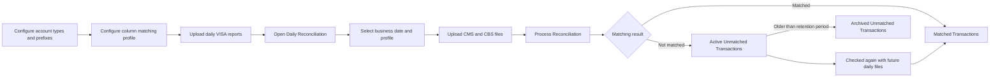

# VISA Details Reconciliation — Workflow and User Manual

## 1. Purpose

VISA Details performs transaction-level reconciliation between:

- VISA detail reports: VX-705, VX-706, VX-707, VX-725, and VX-727
- CMS daily data
- CBS daily data

The system classifies VISA accounts, applies a reusable column-matching profile, matches current data against active unmatched transactions, and separates the result into matched and unmatched records.

## 2. End-to-end workflow

## 3. User roles

### Administrator

Maintains account types, prefix rules, and column-matching profiles. These settings are normally configured once and changed only when a source-file structure or business rule changes.

### Daily operator

Uploads daily files, runs reconciliation, and reviews matched and unmatched transactions. The operator does not need to change technical configuration.

## 4. One-time configuration

Open **Bank System Reconciliation → VISA Details → Configuration**.

### 4.1 Account Types

Create the reusable card/account categories used by the bank.

Example:

| Name | Code | Active |
|---|---|---|
| Gold Card | GOLD | Yes |
| Silver Card | SILVER | Yes |
| American Express | AMEX | Yes |

`Name` is the user-facing description. `Code` is a short unique internal identifier.

### 4.2 Account Type Rules

Map the beginning of an account number to an account type.

Example:

| Prefix | Account Type | Priority |
|---|---|---:|
| 112502 | Gold Card | 10 |
| 12123658 | Silver Card | 10 |
| AAS534 | American Express | 10 |

Rules:

- Prefix length is flexible.
- The longest matching prefix wins.
- Priority resolves rules of equal specificity; a higher priority is evaluated first.
- `Valid From` and `Valid To` can restrict a rule to a specific period.
- Use **Apply Rules** after adding or changing rules to classify existing VISA rows again.

### 4.3 Column Matching Profiles

Create a reusable profile that defines which fields represent the same business value in VISA, CMS, and CBS.

Typical mappings:

| Logical value | VISA column | CMS column | CBS column |
|---|---|---|---|
| Account | Account Number | Account ID | Account Number |
| Reference | Transaction Reference | Reference Number | Reference Number |
| Amount | Transaction Amount | Amount | Transaction Amount |
| Date | Transaction Date | Business Date | Transaction Date |

Recommended setup:

1. Enter a clear profile name, such as `VISA-CMS-CBS Standard Match`.
2. Add one rule per value that must match.
3. Select the corresponding dynamic field for VISA, CMS, and CBS.
4. Select an appropriate normalizer where necessary.
5. Activate the profile.

Use stable identifiers such as account number and transaction reference. Add amount and date when they are required to distinguish otherwise identical transactions.

## 5. Daily reconciliation procedure

### Step 1 — Upload the daily VISA reports

Upload and process the available VX-705, VX-706, VX-707, VX-725, and VX-727 reports through the normal VISA import operation.

Confirm that:

- the reports are processed successfully;
- the report date matches the intended reconciliation business date;
- account types appear on imported VISA records where a prefix rule matches.

### Step 2 — Start Daily Reconciliation

Open **Bank System Reconciliation → VISA Details → Daily Reconciliation**.

Enter:

- **Business Date** — the date of the daily data being reconciled;
- **Matching Profile** — the approved profile for these source files;
- **CMS File** — the current CMS extract;
- **CBS File** — the current CBS extract.

Click **Process Reconciliation**.

The system automatically:

1. imports CMS and CBS data;
2. detects and stores their file columns;
3. resolves the VISA records for the selected business date;
4. applies account-type rules;
5. builds keys from the selected matching profile;
6. checks new records and active unmatched records from the retention window;
7. assigns one shared Match ID to related records;
8. creates matched and unmatched results.

### Step 3 — Review the run

Open **VISA Details → Reconciliation Runs**.

Verify the selected business date, profile, source imports, totals, and run status. Keep the run as the audit record for that processing day.

### Step 4 — Review matched transactions

Open **VISA Details → Matched Transactions**.

Important fields include:

- source and source row number;
- account type;
- Match ID;
- Matched With, such as CMS, CBS, or a VISA report;
- source reference and reconciliation date.

Records carrying the same Match ID belong to the same reconciliation match group.

### Step 5 — Review active unmatched transactions

Open **VISA Details → Active Unmatched Transactions**.

These records remain available for matching with later daily files. Do not re-upload an identical source file; duplicate files are rejected using their file fingerprint.

Investigate unmatched records for:

- incorrect business date;
- a missing daily source file;
- changed or misspelled column headings;
- incomplete matching-profile mappings;
- differences in number formatting, leading zeros, dates, or references;
- a missing account-prefix rule.

## 6. Six-month unmatched-data lifecycle

Active unmatched records remain in the operational matching window for the configured retention period, normally six months.

After the period expires:

- they are moved to **Archived Unmatched Transactions**;
- they remain available for audit and reporting;
- they no longer participate in routine daily matching;
- the active reconciliation tables remain smaller and faster.

## 7. File guidance

### CMS and CBS

Supported formats include CSV, delimited text, XLSX/XLSM, and JSON. The first row should contain unique and meaningful column names.

Recommended minimum fields:

- transaction or reference ID;
- transaction/business date;
- account number or account ID;
- transaction amount;
- debit/credit indicator where available;
- currency where applicable.

### VISA

Supported reports are VX-705, VX-706, VX-707, VX-725, and VX-727. Continue using the existing VISA report import operation.

## 8. Operational controls

- Use one approved active matching profile for each source-file layout.
- Do not modify a live profile casually; create a new profile when a source layout changes materially.
- Do not process the same CMS or CBS file twice.
- Confirm the business date before processing.
- Keep account type codes unique and concise.
- Restrict configuration menus to authorized administrators.
- Review unmatched volumes daily; a sudden increase usually indicates a missing file or changed source format.

## 9. Quick daily checklist

- [ ] VISA VX reports uploaded and processed
- [ ] Correct business date selected
- [ ] Approved matching profile selected
- [ ] CMS file attached
- [ ] CBS file attached
- [ ] Reconciliation completed successfully
- [ ] Matched totals reviewed
- [ ] Active unmatched exceptions reviewed
- [ ] Duplicate or malformed source files investigated

## 10. Common messages

| Message or symptom | Meaning and action |
|---|---|
| File already processed | The same source file was uploaded previously. Use the existing import or select the correct new file. |
| No data rows found | The file is empty or its format cannot expose data rows. Check the header and delimiter. |
| Missing dynamic field | Upload and process a representative source file first, then update the matching profile. |
| High unmatched count | Confirm source dates, file completeness, profile columns, and formatting normalizers. |
| Account Type is blank | No active prefix rule matches the account number for that date. |

